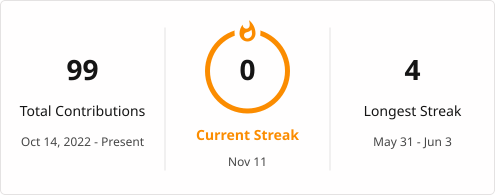

# Chris Babu

**Thrissur, Kerala, India | Open to relocation**

---

### About Me

I'm a Computer Science and Engineering student interested in software development, Linux and building practical applications.

My project experience includes Python applications, web development, computer vision and ESP32-based robotics. I enjoy troubleshooting systems, exploring Linux and understanding how software works beyond the code.

I'm currently pursuing my B.Tech in Computer Science and Engineering at MET's School of Engineering, with an expected completion date of February 2027.

---

### Projects

**Semantic Book Recommendation System**

`Python` `OpenAI Embeddings` `Gradio`

Built a semantic book search application using approximately 5,000 cleaned book records, allowing users to discover books through descriptions and meaning.

**ASL to English Translator**

`Python` `Flask` `OpenCV` `MediaPipe`

Developed a real-time sign recognition application using hand landmarks and coordinate-based rules to recognize 30 signs.

**HR Management System**

`MongoDB` `Express.js` `React` `Node.js`

Developed and locally tested a full-stack HR management application using AI-assisted coding.

**ESP32 Obstacle-Avoiding Robot**

`ESP32` `Sensors` `Servo` `Motor Driver`

Independently built a sensor-driven robot that detects obstacles, scans its surroundings and selects a clear direction.

**Student Management Dashboard**

`Python` `Django`

Developed a student record management application with CRUD functionality.

**College Robotics Club Website**

`HTML` `CSS` `GitHub Pages`

Developed and deployed a static website for the college Robotics Club.

[View All Projects](https://github.com/chrisbabu9?tab=repositories)

---

### Technical Skills

- **Programming:** Python, JavaScript
- **Web Development:** React, Node.js, Express.js, Django, Flask, HTML, CSS
- **Databases:** MongoDB
- **Systems & Tools:** Linux, Ubuntu, Pop!_OS, SSH, WSL, Git
- **Libraries:** OpenCV, MediaPipe, Gradio

---

### Leadership & Achievements

**IEDC — MET's School of Engineering**

- Served in technical leadership and CEO/lead roles during 2024–2026.
- Organized more than 26 events and mentored over 100 students.
- Contributed to the [IEDC website](https://github.com/chrisbabu9/metsiedc).

**Ideathon Winner — Christ College, Irinjalakuda (March 2025)**

Secured first place among 50+ participating teams.

---

### GitHub Activity

---

### Connect

[LinkedIn](https://www.linkedin.com/in/chris-babu/) · [GitHub](https://github.com/chrisbabu9) · [Email](mailto:chrisbabu9@gmail.com)

chrisbabu9@gmail.com

---

### Contributions

"""
